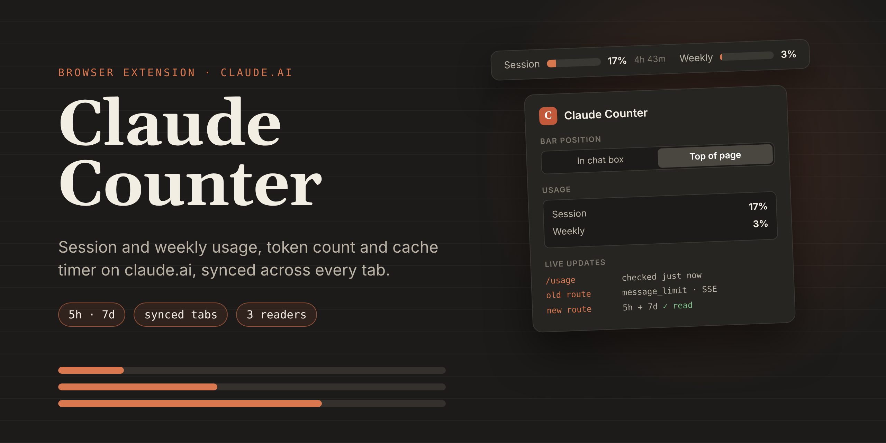

  
  
  
  

# Claude Counter

A browser extension for **claude.ai**: your session (5-hour) and weekly (7-day) usage as live bars, an approximate token count for the open chat, and a cache timer, shared across every open tab.

> Not affiliated with Anthropic. Uses claude.ai's internal, unofficial web API, which can change at any time; see *When claude.ai changes again*.

**Version 0.5.8** · [Changelog](CHANGELOG.md) · [Privacy](PRIVACY.md) · [Contributing](CONTRIBUTING.md)

- **Usage bars**: session and weekly usage with reset countdowns, from Claude's own numbers (unrounded, so more precise than the Settings page).
- **Works on both chat routes**: claude.ai currently serves accounts through an older and a newer chat system; the extension reads usage from either.
- **Synced tabs**: one shared snapshot for all your claude.ai tabs, kept across reloads.
- **Top or inline**: show the bar as a pill at the top of the page or under the message box.
- **Popup diagnostics**: shows what the extension saw on your last message, with a *Copy details* button for bug reports.

Based on [*Claude Counter*](https://github.com/she-llac/claude-counter) by she-llac (MIT), including the composer-anchor fix from an upstream pull request.

---

## Install (Chrome, Edge, Brave)

1. Download this repository: **Code → Download ZIP**, and unzip it somewhere permanent (e.g. `C:\Tools\claude-counter\`).
   *(Or clone it.)*
2. `chrome://extensions` → turn on **Developer mode**.
3. **Load unpacked** → select the unzipped folder (the one with `manifest.json` inside).
   Updating? Replace the folder's files and click ↻ on the extension's card.
4. **Reload your claude.ai tabs** (F5).

**Firefox:** `about:debugging` → **This Firefox** → **Load Temporary Add-on** → pick `manifest.json`.

**Userscript:** [`userscript/claude-counter.user.js`](userscript/claude-counter.user.js) is a separate, older build. It does not have tab sync, the position setting, the popup, or the readers for the newer chat route.

## What it shows

| Item | Where | Notes |
|---|---|---|
| **Session bar** | Top pill or under the message box | 5-hour window, with time until reset |
| **Weekly bar** | Same row | 7-day window |
| **Token count** | Chat header | Approximate (`o200k_base` tokenizer), against a 200k context |
| **Cache timer** | Chat header | How long the conversation stays cached |

> **Known issue:** the token count and cache timer attach to a chat-header element that claude.ai's newer layout no longer has, so on that layout they may not appear. The usage bars are unaffected.
| **Popup** | Toolbar icon | Bar position, last known usage, *Live updates* diagnostics, *Copy details* |

Click the bar to refresh usage right away.

## How usage is read

Three readers run at the same time on every account. Whichever one gets numbers fills the bar; nothing has to be switched.

| Reader | Source | Typical accounts |
|---|---|---|
| **`/usage` check** | `GET /api/organizations/{org}/usage`, on load, when the bar is over 60 s old, and ~2.5 s after each reply | Paid plans (free accounts often get empty windows here) |
| **Older chat route** | the `message_limit` event in the `/completion` text stream | Accounts still on the older chat system |
| **Newer chat route** | the usage windows (`5h`, `7d`) inside the binary protobuf frames of `StreamTimeline` | Accounts moved to the newer chat system |

Streams are recognised by their first bytes, not their content-type label, because claude.ai has sent the same binary stream under two different labels.

### Kept honest
- A value outside 0–1 is rejected, never shown as a wrong percentage.
- If Claude reports nothing for an account, the bar says *Usage: not reported by Claude yet* instead of guessing.
- When a window's reset time passes, the bar zeroes at once and retries until the server confirms the new window.

## When claude.ai changes again

The popup's **Live updates** section says which step stopped working:

| Popup shows | Meaning |
|---|---|
| *Message sent: none seen yet* | The send isn't being seen: claude.ai changed how messages are sent |
| *Other replies … usage keys: no* | The reply was read, but the usage windows weren't found in it: the reply format changed |
| *Usage event … WITHOUT usage windows* | The reply has a usage event with different field names |
| *Usage check … no-windows* (only) | Normal for many free accounts; the live readers fill the bar after your first reply |

To report it, open an issue with the popup's **Copy details** output. For a format change, a **sanitized HAR** helps most:
DevTools → Network → tick *Preserve log* → filter `claudeai-rpc` (or `completion`) → send a short message → wait until no request says *(pending)* → **Save all as HAR (sanitized)**. Use a throwaway chat; a HAR contains the messages you send.

## Privacy

No servers, no analytics. The extension only talks to `claude.ai`, using your existing login, and stores its usage snapshot and settings in your browser. Details: [PRIVACY.md](PRIVACY.md).

## Credits

- Original extension: [Claude Counter](https://github.com/she-llac/claude-counter) by she-llac (MIT)
- Token counting: [gpt-tokenizer](https://github.com/niieani/gpt-tokenizer) (MIT), see [THIRD_PARTY_NOTICES.md](THIRD_PARTY_NOTICES.md)
- Inspired by [Claude Usage Tracker](https://github.com/lugia19/Claude-Usage-Extension) by lugia19

## Licence

[MIT](LICENSE)
